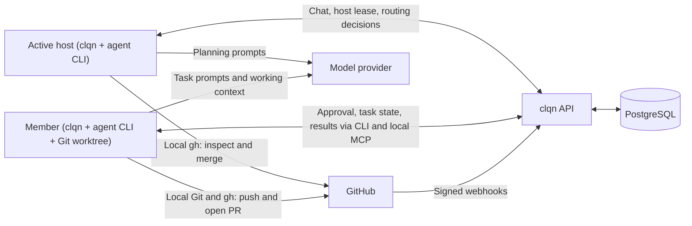

# Architecture and trust boundaries

clqn's hosted or self-hosted API coordinates a clan. The active host runs the orchestrator through its local agent CLI, and the assigned member's computer runs the worker through theirs. Each runtime uses its signed-in model account. Running the API yourself changes where clan data is stored. Model requests still follow the agent runtime's provider and account settings.

## From chat to a pull request

1. **Queue and route.** The API saves chat messages even while every host is offline. One host holds a renewable lease and runs routing and planning turns from shared context. Its clqn process validates and submits the model's proposed actions. Planning subprocesses receive context for their turn and run without clqn action tools or a clqn token.
2. **Approve and run.** The API checks the assigned member's limits and approval settings. Manual approval is the default. Members can opt into automatic approval within their limits. The assigned member's clqn claims the approved task and starts its local worker. The worker accesses clan tools through the local stdio MCP adapter, using an agent credential scoped to the clan.
3. **Publish and review.** A linked repository gives the worker a dedicated task branch and worktree at a recorded base commit. A successful run with repository changes can publish a pull request using local Git and `gh`. The leader's approval in chat applies to a specific commit. The leader's open clqn session checks the PR and attempts the squash merge, subject to GitHub's own permissions, reviews, and checks. [Repository workflow](repositories.md)

## What crosses each boundary

- **clqn API and database.** The server receives identity and clan information, chat messages, shared context, task state, worker results and usage, and repository and PR metadata. The local clone and worktrees are where code is edited. Any code pasted in chat or included in a result becomes part of the shared content. The [database guide](database.md#data-guarantees) describes stored records and [cleanup](database.md#maintenance).
- **Agent runtimes and model providers.** Routing and planning send selected chat and task context to the active host's runtime. Workers receive the approved task and can read project files within the capabilities of their runtime. Their prompts, file contents used as context, and tool output can reach the model provider. Review the provider settings on each host and worker before using sensitive projects.
- **GitHub.** GitHub device sign-in gives the API transient access to verify the account and its primary email. clqn issues its own credential afterward. Repository operations use the local Git and `gh` identities, whose permissions are separate from clqn sign-in. Repository notifications travel back as [signed webhooks](webhooks.md).
- **Member's machine.** A worktree isolates a task's Git checkout. Command permissions depend on the selected runtime and **Worker commands** setting. **Sandboxed** is the default. **Unrestricted** requests the runtime's full command permissions. The runtime can inherit ordinary environment variables from the terminal, so keep unrelated credentials out of the environment used to start clqn. [Agent settings](chat.md#settings)

## Where the code lives

| Workspace | Responsibility |
| --- | --- |
| `packages/cli` | Terminal UI, host and worker processes, local Git and GitHub operations |
| `packages/api` | Hono HTTP API, clan authorization, approval and task state, webhook verification |
| `packages/mcp` | Local stdio adapter for authenticated clqn API calls |
| `packages/shared` | Message contracts and the HTTP client |

See [authentication](authentication.md) for token and account management, or [hosting](hosting.md) to run the API.
